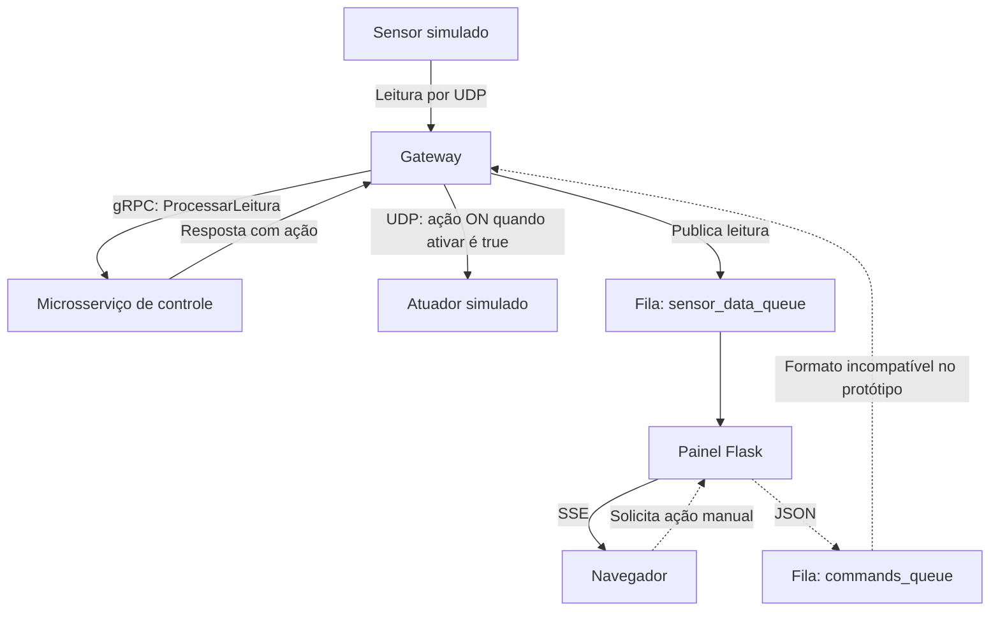

# IoT Cloud Dashboard

Protótipo acadêmico de **monitoramento de sensores simulados em tempo real**, com um gateway que integra UDP, gRPC e RabbitMQ. Um painel Flask recebe as leituras por Server-Sent Events (SSE).

**Python · Flask · UDP · gRPC/Protobuf · RabbitMQ · SSE**

## Arquitetura



As linhas pontilhadas mostram o caminho de controle manual, que ainda precisa de correção de contrato. O painel publica JSON e o gateway espera texto no formato `id:acao`; o controle manual não está integrado de ponta a ponta.

## Componentes

| Arquivo | Responsabilidade |
| --- | --- |
| [`sensor.py`](sensor.py) | Gera leituras aleatórias e envia UDP a cada cinco segundos. |
| [`gateway.py`](gateway.py) | Recebe leituras, consulta a regra gRPC e publica mensagens. |
| [`microsservico.py`](microsservico.py) | Retorna ON se o valor for maior que 30; caso contrário, OFF. |
| [`atuador.py`](atuador.py) | Recebe e registra comandos UDP, sem controlar hardware real. |
| [`painel.py`](painel.py) | Exibe leituras por SSE e publica pedidos de controle manual. |
| [`controle.proto`](controle.proto) | Contrato do serviço gRPC. |

## Preparar o ambiente local

Use Python compatível com as dependências e um RabbitMQ local com um usuário de teste. Na raiz do repositório:

```bash
python -m venv .venv
# Linux/macOS
source .venv/bin/activate
# Windows PowerShell: .\.venv\Scripts\Activate.ps1
python -m pip install -r requirements.txt
python -m pip install pika
```

`pika` é importado pelo gateway e pelo painel, mas ainda não consta em `requirements.txt`. O arquivo também inclui bibliotecas que não são utilizadas no fluxo principal; a revisão das dependências fica como evolução separada.

## Configuração

Defina estas variáveis em **cada terminal** que executar o gateway ou o painel, substituindo os placeholders pelos valores locais. Não grave a senha em um arquivo versionado.

```bash
export RABBITMQ_HOST=127.0.0.1
export RABBITMQ_USER=USUARIO_LOCAL_DE_TESTE
export RABBITMQ_PASS=SENHA_LOCAL_DE_TESTE
```

No PowerShell, a sintaxe equivalente é `$env:RABBITMQ_HOST='127.0.0.1'`, `$env:RABBITMQ_USER='USUARIO_LOCAL_DE_TESTE'` e `$env:RABBITMQ_PASS='SENHA_LOCAL_DE_TESTE'`.

| Variável | Componente que lê | Padrão |
| --- | --- | --- |
| `MICROSERVICE_HOST`, `MICROSERVICE_PORT` | Gateway, destino gRPC | `127.0.0.1`, `50051` |
| `SENSOR_UDP_PORT` | Gateway, porta de entrada UDP | `9999` |
| `GATEWAY_UDP_HOST`, `GATEWAY_UDP_PORT` | Sensor, destino UDP | `127.0.0.1`, `9999` |
| `ACTUATOR_UDP_HOST`, `ACTUATOR_UDP_PORT` | Gateway, destino UDP | `127.0.0.1`, `10000` |
| `WEB_HOST`, `WEB_PORT` | Painel Flask | `127.0.0.1`, `5000` |

O servidor gRPC usa a porta fixa `50051` e o atuador usa a porta fixa `10000`. Alterar apenas as variáveis do gateway não altera os processos servidores. Mantenha as portas padrão no teste local. Gateway e atuador escutam UDP em todas as interfaces; restrinja o acesso na rede local.

## Execução

Com o broker ativo, abra cinco terminais com o ambiente virtual ativado. Configure as variáveis acima nos terminais do gateway e do painel, depois execute, nesta ordem:

```bash
# Terminal 1
python microsservico.py
# Terminal 2
python atuador.py
# Terminal 3
python gateway.py
# Terminal 4
python painel.py
# Terminal 5
python sensor.py 1
```

Abra `http://127.0.0.1:5000`. As leituras devem aparecer no painel; o atuador registra comandos no terminal. Os botões de controle manual ainda não são um critério de sucesso por causa da incompatibilidade descrita acima.

## Validação e limites

Esta documentação foi conferida por leitura dos componentes. Não foi realizada uma nova execução integrada nesta revisão; o repositório não possui uma suíte automatizada nem cobertura medida.

- O gateway só envia a resposta automática quando `ativar` é verdadeiro; a ação OFF devolvida pelo microsserviço não é encaminhada nesse caminho.
- As filas não são duráveis; as leituras do painel ficam em memória, sem histórico em banco de dados.
- O painel usa uma fila SSE compartilhada; múltiplos navegadores podem disputar os eventos.
- O painel pode descartar uma leitura de valor zero por usar uma seleção baseada em valor verdadeiro na extração da mensagem.
- Não há autenticação da interface, TLS no gRPC ou garantias de produção.

## Próximas evoluções

1. Unificar o contrato de comandos entre painel e gateway e validar ON/OFF.
2. Organizar dependências e criar testes de integração locais.
3. Persistir leituras com esquema e timestamp; acrescentar consultas SQL de agregação e verificações de qualidade, como evolução em direção à engenharia de dados.

Projeto educacional, sem hardware ou dados de clientes. Use apenas credenciais locais de teste. Caso alguma credencial de versões anteriores permaneça ativa, revogue-a no provedor. Não exponha este protótipo à internet sem tratar autenticação, transporte e regras de rede.
